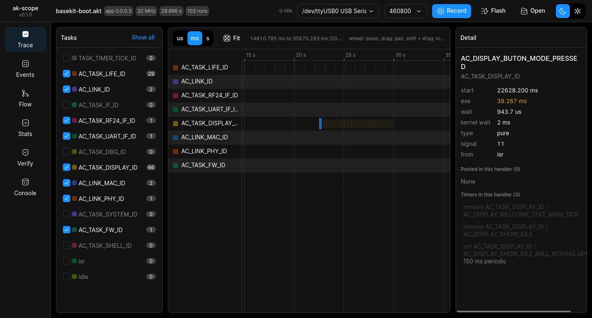
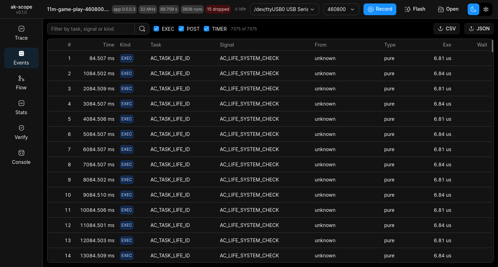
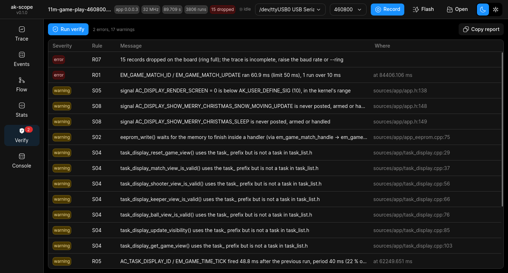
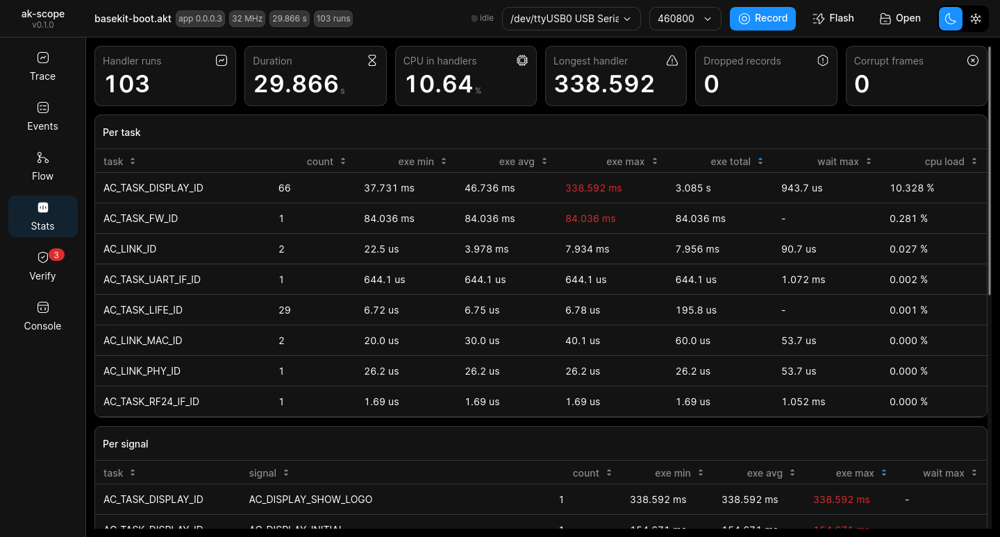
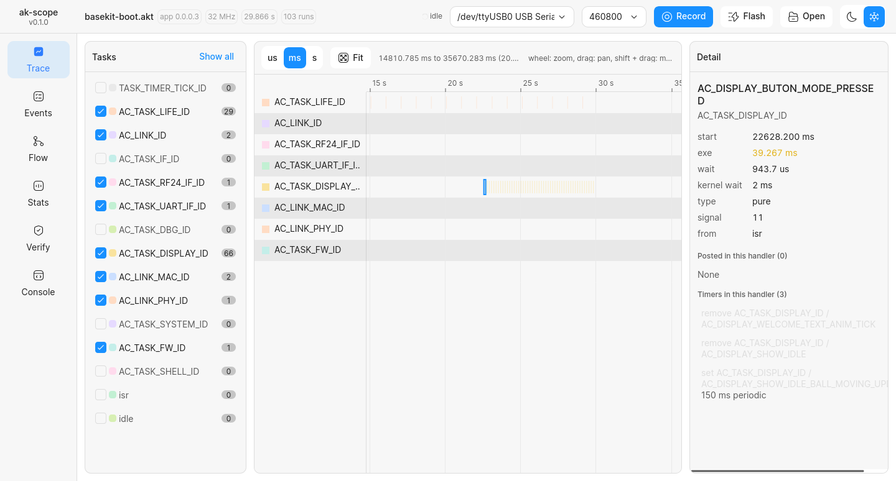

# ak-scope
Record, visualize and verify task messages, signals and timers in AK event-driven firmware.

ak-scope works with projects built on the
[AK base kit](https://github.com/the-ak-foundation/ak-base-kit-stm32l151) (AK kernel 1.3,
STM32L151). It links a small trace module into the firmware without changing the project,
flashes it with `ak-flash`, reads the trace from the console UART, shows it in a local web page,
and checks the firmware against the AK rules.



| | |
| --- | --- |
|  |  |
|  |  |

## Install

Needs Python 3.10 or newer.

```sh
pip install .
```

On Ubuntu 22.04 the system pip (22.0) cannot read this package and installs it as `UNKNOWN`;
update pip for your user first. To work on ak-scope, install it editable, so the `akscope`
command runs the code of the checkout:

```sh
python3 -m pip install --user -U pip
python3 -m pip install --user -e .
```

For building and flashing the firmware you also need what the AK base kit uses:

- the ARM toolchain `gcc-arm-none-eabi-10.3-2021.10`
- [ak-flash](https://github.com/ak-embedded-software/ak-flash) on the `PATH`

For the desktop window (`akscope app`) the system packages of GTK 3 and WebKit2GTK 4.0:

```sh
sudo apt install python3-gi gir1.2-gtk-3.0 gir1.2-webkit2-4.0
```

Tested on Ubuntu 22.04 with the AK kit on a CH340 USB serial adapter. Windows is not tested yet.

ak-flash asks the running firmware for its bootloader at 115200 baud. A build with another
console rate (`akscope build --console-baud 460800`) does not understand that, so ak-scope first
types the base kit shell command `fwu` at the console rate, which restarts the kit into the
bootloader. A firmware without that command needs the boot mode buttons (hold MODE, press and
release RESET, keep MODE held until the LIFE LED blinks fast); the error message says so.

## Quick start

```sh
# 1. build the project with the trace linked in; the project folder is not written to
akscope build ~/workspace/my-game --tools ~/workspace/tools

# 2. open the page, then Flash (writes the firmware, records from boot) or Record
akscope serve --project ~/workspace/my-game --dev /dev/ttyUSB0

# 3. check the sources and a recorded trace against the AK rules
akscope verify ~/workspace/my-game --trace captures/run-20261022-101500.akt
```

`--tools` is the folder the AK Makefile calls `WORKSPACE_TOOLS_PATH` (it holds
`gcc-arm-none-eabi-10.3-2021.10-x86_64-linux`). It is remembered for the project, so later
commands do not need it.

For a game that sends many messages, build with `--console-baud 460800`. At 115200 a busy
game lost 43 % of its records while being played; at 460800 it lost 0.2 %. `record` and
`serve` pick up the rate of the project; the bootloader keeps its own rate, so its banner reads
as noise and is ignored.

## Commands

| Command | Does |
| --- | --- |
| `akscope build <project>` | builds the project with the trace linked in, objects in `~/.cache/akscope/build/`; also writes the task and signal names |
| `akscope flash --port <dev> <project or .bin>` | flashes with `ak-flash`, retrying when the running trace breaks the handshake; `--baud` is the console rate of the firmware on the kit |
| `akscope record --port <dev> -o run.akt [--flash <project>]` | captures the UART to a `.akt` file; with `--flash`, flashes first and records from boot |
| `akscope dump run.akt` | prints the records with task and signal names |
| `akscope serve [run.akt] [--project <project>] [--dev <dev>]` | web page on `http://127.0.0.1:8730` |
| `akscope app [run.akt] [--project <project>] [--dev <dev>]` | the same page in a desktop window |
| `akscope install-desktop [--project <project>]` | adds ak-scope to the desktop menu |
| `akscope verify [<project>] [--trace run.akt]` | static and runtime rule checks, text or `--format json` |
| `akscope import-log console.txt`, `akscope stats console.txt` | read the kernel's own task log (`LOG_AK_KERNEL_ENABLE`) from firmware without the trace |

`akscope <command> --help` lists every option.

## The web page and the desktop window

```
akscope serve --project ~/workspace/my-game --dev /dev/ttyUSB0    # in the browser
akscope app --project ~/workspace/my-game --dev /dev/ttyUSB0      # in its own window
```

Both show the same page: the top bar holds the trace facts, the serial port, Record, Flash and
Open; the side bar switches between the views. The look follows the design system file in
Figma, dark and light.

- **Trace**: the tasks, the timeline and the detail of the selected run.
- **Timeline**: one row per task, higher priority first. A block is one handler run; an arrow
  goes from the post to the run it caused; a tick marks a run started by a timer. Wheel to
  zoom, drag to pan, shift and drag to measure, `f` to fit.
- **Detail**: for the selected run, its run time, its exact queue wait, who posted it, and what
  it posted, each a link to follow the chain. With the base kit's debug prints on
  (`APP_DBG_SIG_EN`), the console lines the run printed, matched by the `-SIG-> NAME` line it
  starts with, and how long sending them held the handler.
- **Events**: every record, with a filter; export the filtered rows as CSV or JSON.
- **Flow**: the messages in the timeline view as a sequence diagram.
- **Stats**: run time per task and per signal, CPU share, longest handler.
- **Verify**: the rule checks for this trace, and for the project sources when `--project` is
  given. Click a runtime finding to jump to the run.
- **Record / Flash**: live capture into `captures/`, the view follows the newest records.

The desktop window runs the server in its own process on a free port, asks where to save an
export, keeps its size per project in `~/.config/akscope/window.json`, and raises the open
window when started again for the same project. `akscope install-desktop` writes the menu entry
to `~/.local/share/applications/`.

The server only listens on 127.0.0.1, only opens serial ports the machine lists, only flashes
the `--project` firmware, and refuses requests that do not come from its own page.

A decoded capture is kept in `~/.cache/akscope/decoded/` (the last 20), so a large trace opens
at once the second time. Decoding is plain Python: about 10 s for 100 000 handler runs the
first time.

## Verify

```sh
akscope verify ~/workspace/ak-base-kit-stm32l151 --trace samples/base-kit-boot-akt.bin
```

```
@ 130.985 ms: error R01 AC_TASK_DISPLAY_ID / AC_DISPLAY_INITIAL ran 154.7 ms (limit 50 ms), 1 run over 10 ms
@ 2130.991 ms: error R01 AC_TASK_DISPLAY_ID / AC_DISPLAY_SHOW_LOGO ran 338.6 ms (limit 50 ms), 1 run over 10 ms
@ 5031.042 ms: error R01 AC_TASK_FW_ID / FW_CHECKING_REQ ran 84.0 ms (limit 50 ms), 1 run over 10 ms
...
3 errors, 4 warnings
```

The base kit's own application keeps every static rule; its display handlers run long. A game
built on it can also get findings such as a framework file changed (S01), register access
outside `io_cfg.c` (S03) or a global written by several tasks (S10).

Thirteen static rules (blocking calls in handlers, IO outside `io_cfg.c`, signals posted but
not handled, globals shared between tasks, ISR rules, debug prints on a blocking console...) and eight runtime rules (handler run
time, queue wait, pool use, message storms, timer drift, expected sequences...). Code that
comes unchanged from the base kit is left out when the kit is checked out next to the project.
See [docs/verify-rules.md](docs/verify-rules.md) for every rule, its limits, and the rules
file (thresholds, ignores, expected sequences).

## Firmware without the trace

Firmware that was not built with `akscope build` sends no message records; ak-scope can only
show its console text. If it was built with the kernel task log
(`LOG_AK_KERNEL_ENABLE=-DAK_TASK_LOG_CONSOLE_ENABLE`), `akscope stats` gives run and wait
times per task from it, in milliseconds and without the sender.

## Documents

- [docs/trace-format.md](docs/trace-format.md): the bytes on the wire and in `.akt` files
- [docs/verify-rules.md](docs/verify-rules.md): the static and runtime rules
- [akscope/firmware/akt/README.md](akscope/firmware/akt/README.md): how the trace is linked in,
  adding it by hand, known issues
- [samples/](samples/): captures from a real kit, used by the tests

## Development

```sh
python3 -m unittest
```

The tests use the captures in `samples/` and need no board. The web page is plain JavaScript
modules under `akscope/web/`, no build step.

The components of the page are compared with the Figma file pixel by pixel
(`akscope/web/gallery.html`, `tools/figma/compare.py`). The icons are drawn from the Figma file
and not kept in the repository:

```sh
python3 tools/figma/export.py all "[WEB - 1] Design system VMS.fig"   # tokens, icons, spec
AKSCOPE_FIG="[WEB - 1] Design system VMS.fig" python3 -m unittest tests.test_figma_gallery
```

The comparison needs Firefox, geckodriver, PyGObject with librsvg, and Pillow.
